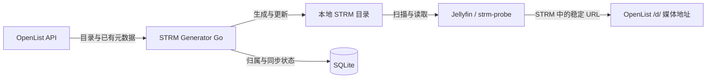

# STRM Generator Go

把 OpenList 中的媒体目录同步为本地 STRM，让 Jellyfin 读取本地目录、通过 OpenList 访问媒体。

一个独立运行的 Go 命令行工具，支持增量更新、定时同步和 Mirror 清理，可配合
[jellyfin-strm-probe](https://github.com/kentinya/jellyfin-strm-probe) 使用。
部署目标为 **Linux amd64 / arm64**，支持 Docker Compose 和二进制运行。

[快速开始](#-快速开始) · [配置说明](#-配置说明) · [常用命令](#-常用命令) · [文档导航](#-文档导航)

## ✨ 特性

- **目录映射**：保留源目录层级，将媒体扩展名替换为 `.strm`，支持配置多个源目录。
- **自定义扩展名**：`sync.media_extensions` 决定生成哪些后缀；省略时沿用内置 11 项。
- **增量同步**：依次比较 URL、有效 SHA-1 和 Size；无变化时保留文件内容与修改时间。
- **稳定链接**：生成 OpenList `/d/` 地址，逐段编码路径，不写入临时签名链接。
- **插件元数据**：将源端已有的有效 SHA-1、Size 写入 V1 STRM，供配套插件比较与复用媒体信息。
- **按需运行**：一次性 `sync` 或常驻 `serve`；定时模式启动后立即同步，默认每 60 分钟执行一轮。
- **预览变更**：`--dry-run` 预览同步，不修改 STRM、原数据库、轮次或缺失计数。
- **Mirror 清理**：默认关闭；启用后至少经过三次完整成功轮的缺失确认，并在删除前重新核对。
- **文件保护与恢复**：只维护可靠归属的文件，支持原子写入、正常中断后重试和跨进程互斥。

## 🏗️ 工作原理



例如，将 `/Movies` 映射到本地输出目录后：

```text
OpenList                         本地输出
/Movies/                         /output/Movies/
└── Example/                      └── Example/
    └── Movie.mkv                     └── Movie.strm
```

STRM 包含稳定 URL，以及源端可用的有效 SHA-1、Size。SQLite 只保存文件归属、路径、
完整轮次和缺失计数，媒体指纹从 STRM 读取。生成器不下载媒体补算哈希，也不运行 ffprobe；
Jellyfin 扫描和插件检查由各自负责。模块设计见[架构说明](docs/architecture.md)。

## 🚀 快速开始

以下命令在仓库根目录执行。开始前需要一个可访问的 OpenList 实例、API token，
以及可供媒体消费者访问的稳定 `/d/` 地址。要求临时签名的挂载不满足当前使用前提。

### Docker Compose

需要 Docker、Compose 和 Buildx。先构建本机架构镜像并准备配置：

```bash
docker buildx build --load --tag strmgen:local .
cp deploy/config.example.yaml deploy/config.yaml
mkdir -p deploy/data/output deploy/data/state deploy/data/locks
```

编辑 `deploy/config.yaml` 中的 `openlist.api_url`、`openlist.public_url` 和
`sources[].remote`。保留容器内的 `/output`、`/state` 路径，输出默认落在宿主机
`deploy/data/output/`，数据库落在 `deploy/data/state/`。

`api_url` 必须能从容器内访问。OpenList 运行在宿主机时，可使用
`http://host.docker.internal:5244`，端口按实际设置；示例中的 `http://openlist:5244`
需要两个容器处于同一 Docker 网络且能解析该名称。

注入 token 和挂载目录的运行身份，先预览，再启动定时同步：

```bash
export OPENLIST_TOKEN='替换为你的 OpenList token'
export STRMGEN_UID="$(id -u)"
export STRMGEN_GID="$(id -g)"

docker compose -f deploy/compose.yaml run --rm strmgen \
  sync --config /etc/strmgen/config.yaml --dry-run
docker compose -f deploy/compose.yaml up -d
docker compose -f deploy/compose.yaml logs -f
```

挂载目录须由上述 UID/GID 拥有且可写；如果之前由其他身份创建，先按
[部署说明](docs/deployment.md#compose-运行)调整权限。token 仅通过运行时环境注入，
不要写入 YAML 或提交到仓库。

停止服务：

```bash
docker compose -f deploy/compose.yaml stop -t 60
```

已有发布镜像可通过 `STRMGEN_IMAGE` 指定实际镜像引用；Compose 默认使用本地
`strmgen:local`。镜像发布、挂载自定义路径与多实例配置见[部署说明](docs/deployment.md)。

### 二进制运行

需要 Linux、Python 3.11+、Git 和下载固定 Go SDK 的 HTTPS 网络：

```bash
python3 scripts/development_environment.py install
mkdir -p artifacts/bin
bash scripts/go-local build -trimpath -o artifacts/bin/strmgen ./cmd/strmgen
cp config.example.yaml config.yaml
```

按下节修改 `config.yaml`，设置专用输出与数据库路径，再运行：

```bash
export OPENLIST_TOKEN='替换为你的 OpenList token'
./artifacts/bin/strmgen sync --config config.yaml --dry-run
./artifacts/bin/strmgen sync --config config.yaml
./artifacts/bin/strmgen serve --config config.yaml
```

## ⚙️ 配置说明

本机运行参考 [config.example.yaml](config.example.yaml)，容器运行参考
[deploy/config.example.yaml](deploy/config.example.yaml)。两者使用相同配置格式，
文件路径分别对应宿主机和容器内路径。

| 配置项 | 说明 | 默认值 / 要求 |
|---|---|---|
| `openlist.api_url` | 生成器访问的 OpenList API 地址 | 必填 |
| `openlist.public_url` | 写入 STRM 的公开地址前缀，程序追加 `/d/` 和媒体路径 | 必填，须能由媒体消费者访问 |
| `openlist.token_env` | 保存 API token 的环境变量名 | 必填，示例为 `OPENLIST_TOKEN` |
| `sources[].remote` | OpenList 源目录 | 必填，远端绝对路径 |
| `sources[].output` | 对应的本地 STRM 输出根 | 必填，各输出根不能重叠 |
| `database.path` | SQLite 状态库位置 | 必填，放在输出根之外并持久保存 |
| `sync.interval_minutes` | 定时同步间隔，单位为分钟 | `60`；`serve` 要求正整数 |
| `sync.directory_workers` | 并行读取目录的工作数 | `4`，范围 `1–32` |
| `sync.mirror` | 启用镜像对账，清理还需单独开启 | `true` |
| `sync.media_extensions` | 生成哪些源文件扩展名；显式列表完整替换默认项 | 省略时用内置 11 项，见下节 |
| `cleanup.enabled` | 是否清理已确认缺失的自有 STRM | `false` |
| `cleanup.missing_confirmations` | 清理前所需的完整成功轮缺失次数 | `3`，最低 `3` |

相对输出与数据库路径均按**进程启动工作目录**解析。`sync.atomic_write` 和
`sync.skip_unchanged` 在示例中均为 `true`，当前实现要求保持开启。

### 自定义扩展名

`sync.media_extensions` 决定哪些源文件会生成 STRM。省略该字段时使用内置 11 项：
`.mkv`、`.mp4`、`.m4v`、`.avi`、`.mov`、`.wmv`、`.webm`、`.ts`、`.m2ts`、`.mpg`、`.mpeg`。
旧配置无需修改。

显式列表**完整替换**默认项，不与默认值合并：

```yaml
sync:
  media_extensions: [".mkv", ".mp4", ".flv", ".mp3", ".flac"]
```

- 每项可带一个前导点，大小写和首尾空白会被规范化，重复项合并，例如
  `MKV`、`.mkv`、` .MKV ` 等价。
- 必须是非空字符串列表。空列表、`null`、单个字符串、非字符串元素、空项、路径、
  通配符、多段后缀（如 `.tar.gz`）和 `.strm` 都会被拒绝，命令以退出码 `2` 在访问
  API、创建输出或数据库之前结束。
- 只匹配文件名最后一个扩展名，大小写无关；目录始终遍历，不按目录名筛选。
  `.mp4` 匹配 `Movie.MP4`，不匹配 `Movie.mp4.bak`。
- `sync`、`sync --dry-run` 与 `serve` 使用同一列表。`serve` 在启动时读取配置，
  修改后需**重启**才生效；运行中的进程不会热加载。

**移除扩展名后的清理**：把某个扩展名从列表中移除后，对应源文件不再生成或更新，
已有可靠归属的 STRM 会被视为不再需要的输出，按普通缺失计数处理——即使该源文件
仍然存在且可读取。`cleanup.enabled` 默认仍为 `false`，关闭时不计数也不删除；开启后
仍需每个完整成功轮累计一次、达到 `cleanup.missing_confirmations`（默认与最低 `3`）
并经过删除前重核才会删除。把扩展名加回列表且源文件可读时，计数清零并保留文件；
若已按阈值删除，后续同步会重新生成。清单只表示允许生成链接，不承诺对应格式能被
Jellyfin 或插件播放。

## 💻 常用命令

以下以本机二进制为例：

| 操作 | 命令 |
|---|---|
| 查看帮助 | `./artifacts/bin/strmgen help` |
| 预览一轮同步 | `./artifacts/bin/strmgen sync --config config.yaml --dry-run` |
| 执行一轮同步 | `./artifacts/bin/strmgen sync --config config.yaml` |
| 启动定时同步 | `./artifacts/bin/strmgen serve --config config.yaml` |

容器内执行一次性同步：

```bash
docker compose -f deploy/compose.yaml run --rm strmgen \
  sync --config /etc/strmgen/config.yaml
```

退出码：`0` 成功，`1` 运行失败、锁忙或取消，`2` 参数或配置错误。
`serve` 收到 SIGINT / SIGTERM 后取消当前轮并释放锁，不提交不完整轮。

## 🗂️ 清理与恢复

- **清理需显式开启**：同时设置 `cleanup.enabled: true` 与 `sync.mirror: true`。
  至少连续三次完整成功轮确认缺失，并在删除前再次核对当前源根与目标 Get。
- **源根不可读时保留**：不推进缺失计数；源根可读而目标 Get 未读到时计缺失，
  即使原因是权限、驱动或缓存异常。完整规则见[缺失确认](docs/requirements.md#完整轮与缺失确认)。
- **只处理自有文件**：不自动接管、覆盖或删除未归属文件；同名映射冲突会报告失败。
- **数据库需要备份**：丢失状态库后不会自动认领已有 STRM。先停生成器，再备份状态目录
  （含 SQLite sidecar）和输出目录；恢复时优先使用可信备份。
- **共享输出必须共享锁**：生成器负责写入，消费者只读。多个生成器须使用同一锁对象；
  运行时不要删除 `/tmp/strmgen-locks/sync.lock` 或 SQLite sidecar。
- **普通中断可重试**：人工处理残留前先停止生成器并备份，具体步骤见
  [状态、备份与恢复](docs/deployment.md#状态备份与恢复)。

## 🛠️ 本地开发

仓库固定 Go SDK 和依赖版本。完成 SDK 安装后，可运行：

```bash
python3 scripts/check_governance.py
bash scripts/go-local test ./...
```

统一质量检查包含治理、Python 回归、格式、vet、Go test / build：

```bash
python3 scripts/quality.py
```

race 所需的固定 C 工具链、合成 OpenList 夹具、真实服务集成与故障恢复见
[开发流程](docs/development-workflow.md)。

## 📁 项目结构

```text
├── cmd/strmgen/          # CLI 入口与依赖装配
├── internal/            # 配置、OpenList、STRM、对账、存储与调度
├── deploy/              # Compose 与容器配置示例
├── dev/                 # 固定环境规范与合成夹具
├── scripts/             # 环境安装、质量检查与隔离集成工具
├── tests/               # Python 工具回归
├── docs/                # 部署、需求、架构与开发文档
├── config.example.yaml  # 本机运行配置示例
└── Dockerfile           # Linux amd64 / arm64 镜像构建
```

## 📚 文档导航

仓库维护以下 10 份文档，已完成任务的过程记录从 Git 历史查阅。

| 文档 | 内容 |
|---|---|
| 本 README | 项目介绍、快速开始与日常入口 |
| [部署](docs/deployment.md) | Docker / Compose、发布、权限、备份与恢复 |
| [需求](docs/requirements.md) | V4.4 业务规则、STRM 协议与比较矩阵 |
| [架构](docs/architecture.md) | 模块职责、数据流、持久化与并发设计 |
| [开发流程](docs/development-workflow.md) | 环境、测试、任务审查与历史查看 |
| [路线图](docs/roadmap.md) | 已交付能力与最终验收索引 |
| [SLICE](SLICE.md) | 当前能力合同与规划状态 |
| [TASK](TASK.md) | 当前产品实施任务状态 |
| [AGENTS](AGENTS.md) | 仓库开发约束 |
| [CLAUDE](CLAUDE.md) | 开发工具入口 |

当前 V4.4 需求已完成，Slice 1–4 **PASS / CLOSED**。已验收固定 10000 文件生成、
最少同步样本、Jellyfin 原始扫描与插件八行实际决定。探测启动不等于探测成功；
ARM64 原生实机与正式发布验收未包含在原合同内，具体证据与边界见[路线图](docs/roadmap.md)。

[Slice 5：配置自定义扩展名](SLICE.md) 的实现已提交给独立 B 审查，当前 Task 状态见
[TASK](TASK.md)。说明与边界以本文配置章节、[需求](docs/requirements.md)和
[架构](docs/architecture.md)为准；产品验收结论以独立审查记录为准。
