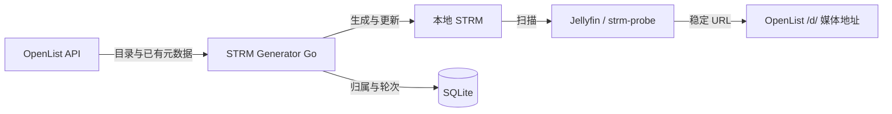

# STRM Generator Go

将 OpenList 媒体目录同步为本地 STRM，供 Jellyfin 扫描，通过 OpenList 的稳定地址读取媒体。
独立 Go 命令行工具，支持 **Linux amd64 / arm64**、Docker Compose 和二进制运行。
可配合 [jellyfin-strm-probe](https://github.com/kentinya/jellyfin-strm-probe) 使用。

**当前版本：v1.2.0** · [下载 Release](https://github.com/kentinya/STRM-Generator-GO/releases/latest) ·
[快速开始](#快速开始) · [配置](#配置) · [Telegram 通知](#telegram-通知) · [升级](#升级)

## 特性

- **目录镜像**：支持多个源目录，保留目录层级，按扩展名筛选并生成 `.strm`。
- **增量更新**：依次比较 URL、有效 SHA-1、Size；未变化时保留文件内容与修改时间。
- **稳定链接**：写入逐段编码的 OpenList `/d/` 地址，不使用临时签名 URL。
- **定时同步**：`sync` 执行一次；`serve` 启动即同步，默认每 60 分钟运行一轮。
- **安全清理**：默认关闭；只处理可靠归属的 STRM，累计至少三次完整成功轮的缺失记录，删除前再次核对。
- **预览与恢复**：`--dry-run` 不修改输出、原数据库或计数；支持跨进程互斥和正常中断后的重试恢复。
- **Telegram 通知**：v1.2.0 新增，每轮带图标的 HTML 摘要、文件变化与清理进度，明细过多时附文本清单；默认关闭。



生成器不下载媒体补算哈希、不运行 ffprobe，也不操作 Jellyfin 或插件的数据库。
源端已有的有效 SHA-1、Size 会写入 V1 STRM；SQLite 只保存归属、路径、完整轮次和缺失计数。

## 快速开始

先准备可访问的 OpenList API、API token，以及媒体消费者能访问的稳定 `/d/` 地址。
要求临时签名的挂载不满足当前使用前提。

### 下载二进制

从 [Releases](https://github.com/kentinya/STRM-Generator-GO/releases) 下载对应架构的压缩包和
`SHA256SUMS.txt`。预编译包只需 Linux 运行环境，无需安装 Go 或 Python。
下面以 v1.2.0 为例，在一个新的安装目录内执行：

```bash
mkdir strmgen-v1.2.0
cd strmgen-v1.2.0
case "$(uname -m)" in
  x86_64) arch=amd64 ;;
  aarch64|arm64) arch=arm64 ;;
  *) echo '仅提供 Linux amd64 / arm64 安装包'; exit 1 ;;
esac
release_url='https://github.com/kentinya/STRM-Generator-GO/releases/download/v1.2.0'
curl -fLO "$release_url/strmgen_v1.2.0_linux_${arch}.tar.gz"
curl -fLO "$release_url/SHA256SUMS.txt"
sha256sum --check --ignore-missing SHA256SUMS.txt && \
  tar -xzf "strmgen_v1.2.0_linux_${arch}.tar.gz"
cp config.example.yaml config.yaml
```

编辑 `config.yaml`，尤其是 OpenList 地址、`sources[].remote`、`sources[].output` 和
`database.path`。示例输出位置仅供参考，改为你的专用输出与状态目录。然后先预览再同步：

```bash
export OPENLIST_TOKEN='替换为你的 OpenList token'
./strmgen sync --config config.yaml --dry-run
./strmgen sync --config config.yaml
./strmgen serve --config config.yaml
```

### Docker Compose

在仓库根目录构建本机架构镜像并准备配置：

```bash
git clone https://github.com/kentinya/STRM-Generator-GO.git
cd STRM-Generator-GO
git checkout v1.2.0
docker buildx build --load --tag strmgen:local .
cp deploy/config.example.yaml deploy/config.yaml
mkdir -p deploy/data/output deploy/data/state deploy/data/locks
```

编辑 `deploy/config.yaml` 中的 OpenList 地址和源目录，保留 `/output`、`/state` 容器路径。
默认输出和数据库分别落在宿主机 `deploy/data/output/`、`deploy/data/state/`。
OpenList 在宿主机运行时，API 地址可使用 `http://host.docker.internal:5244`；
示例中的 `http://openlist:5244` 要求容器在同一 Docker 网络且能解析该名称。

```bash
export OPENLIST_TOKEN='替换为你的 OpenList token'
export STRMGEN_UID="$(id -u)"
export STRMGEN_GID="$(id -g)"
docker compose -f deploy/compose.yaml run --rm strmgen \
  sync --config /etc/strmgen/config.yaml --dry-run
docker compose -f deploy/compose.yaml up -d
docker compose -f deploy/compose.yaml logs -f
```

挂载目录须由运行 UID/GID 拥有且可写。停止服务用
`docker compose -f deploy/compose.yaml stop -t 60`。
已发布镜像可通过 `STRMGEN_IMAGE` 指定实际引用；Compose 默认使用 `strmgen:local`。
镜像发布、权限和多实例部署见[部署文档](docs/deployment.md)。

## 配置

完整示例：[本机](config.example.yaml) / [容器](deploy/config.example.yaml)。
相对输出与数据库路径按**进程启动工作目录**解析；数据库应位于输出根之外并持久保存。
Token 只通过环境变量注入，不写入 YAML。

| 配置项 | 含义与默认值 |
|---|---|
| `openlist.api_url` | 生成器访问的 API 地址，必填 |
| `openlist.public_url` | 写入 STRM 的地址前缀，程序追加 `/d/` 和媒体路径，必填 |
| `openlist.token_env` | API token 的环境变量名，示例为 `OPENLIST_TOKEN`，必填 |
| `sources[].remote` / `sources[].output` | 远端绝对目录 / 本地输出根，必填；输出根不能重叠 |
| `database.path` | SQLite 状态库，必填 |
| `sync.interval_minutes` | 默认 `60`；`serve` 要求正整数，单次同步允许 `0` |
| `sync.directory_workers` | 默认 `4`，范围 `1–32` |
| `sync.media_extensions` | 省略时使用内置 11 项；显式列表完整替换默认值 |
| `sync.mirror` | 默认 `true`；清理另需显式开启 |
| `cleanup.enabled` / `cleanup.missing_confirmations` | 默认 `false` / `3`，阈值最低 `3` |
| `notifications.telegram.enabled` | 默认 `false` |

`sync.atomic_write` 与 `sync.skip_unchanged` 当前要求保持开启。

### 自定义扩展名

内置列表为 `.mkv`、`.mp4`、`.m4v`、`.avi`、`.mov`、`.wmv`、`.webm`、`.ts`、`.m2ts`、`.mpg`、`.mpeg`。
覆盖示例：

```yaml
sync:
  media_extensions: [".mkv", ".mp4", ".flv", ".mp3", ".flac"]
```

只匹配最后一个扩展名，忽略大小写，目录始终遍历；列表不能为空，不接受路径、通配符、
多段后缀或 `.strm`。可省略前导点，首尾空白与重复项会被规范化。

**移除扩展名会影响已有输出**：开启清理后，即使源文件仍存在，已归属 STRM 也进入正常
缺失计数与清理流程。加回扩展名且源文件可读时清零保留，已删除的文件会重新生成。
完整规则见[自定义扩展名](docs/requirements.md#自定义扩展名)。

## Telegram 通知

启用配置并向运行环境提供 Bot Token 和目标 Chat ID；使用私聊前先在 Telegram 中向 Bot
发起会话。Compose 示例已透传下面两个默认环境变量。

```yaml
notifications:
  telegram:
    enabled: true
    instance_name: "家庭媒体"
    bot_token_env: "TELEGRAM_BOT_TOKEN"
    chat_id_env: "TELEGRAM_CHAT_ID"
    policy: "change_or_error"
```

```bash
export TELEGRAM_BOT_TOKEN='替换为 Bot Token'
export TELEGRAM_CHAT_ID='替换为目标 Chat ID'
```

| 策略 | 发送时机 |
|---|---|
| `all`（默认） | 每轮完成后发送 |
| `change_or_error` | 有新增、更新、实际删除、归属回收、已提交缺失计数变化，或同步失败 |
| `error` | 同步失败或初始化失败 |

摘要聚合所有来源，以 Telegram HTML 格式显示粗体结果标题、固定图标和分行统计：
实例、来源、耗时、时间与文件事件都有固定标识；新增、更新、删除、归属回收、清理
计数推进／恢复等操作带对应图标。来源失败、冲突与安全保留诊断排在文件事件之前；
文件事件保留来源编号和输出根内完整相对路径。正文最多预览 20 条事件，5 条以内直接
展示，6 条起收进一个可展开引用块；超量附单个 UTF-8 纯文本清单（上限 8 MiB，超限
明确标为不完整）。完整待发送 HTML（含标签与实体）不超过 3500 UTF-16 code units。
通知在锁与本地资源释放后发送，失败只记录脱敏警告，不改变同步结果、退出码或调度。
凭证缺失时跳过通知，同步继续；`dry-run`、锁忙和取消不发送。单轮发送预算 30 秒，无重试。

`serve` 在启动时读取配置与凭证；修改后需重启。更多边界见[需求 R-14](docs/requirements.md)。

## 升级

从 v1.1.0 升级到 v1.2.0，旧配置可继续使用，Telegram 通知默认关闭。
先停止生成器并备份输出、状态目录（含 SQLite sidecar）和配置，再替换二进制或镜像。
保留原数据库、输出映射和共享锁目录，先运行 `sync --dry-run`，核对后恢复同步。

配置、通知与扩展名均在进程启动时读取；Compose 使用
`docker compose -f deploy/compose.yaml up -d --force-recreate` 重新创建容器。
普通配置修改无需删除状态库或重新认领已有文件。

## 运行与恢复

| 操作 | 二进制命令 |
|---|---|
| 查看帮助 | `./strmgen help` |
| 预览 / 执行一次 | `./strmgen sync --config config.yaml [--dry-run]` |
| 定时运行 | `./strmgen serve --config config.yaml` |

退出码：`0` 成功，`1` 运行失败、锁忙或取消，`2` 参数或配置错误。

- 清理须同时开启 `cleanup.enabled` 与 `sync.mirror`；不完整轮不推进缺失计数。
- 源根不可读时冻结缺失；源根可读但目标 Get 未读到时计缺失，包括权限、驱动或缓存异常。
- 不自动认领、覆盖或删除未归属文件；丢失数据库后优先恢复可信备份。
- 生成器写输出，消费者只读；共享输出的多个生成器必须共享同一锁对象。
- 普通中断后可重试；不要在运行时删除锁文件或 SQLite sidecar。

备份、挂载和恢复步骤见[部署文档](docs/deployment.md#状态备份与恢复)。

## 开发与文档

源码构建使用仓库固定的 Go SDK；开发、测试和依赖安装统一见[开发流程](docs/development-workflow.md)。
发布包提供双架构构建，ARM64 原生实机运行尚未验收；分层证据与历史限制见[路线图](docs/roadmap.md)。

仓库维护以下 10 份文档；已完成任务的过程记录保存在固定 Git 检查点。

| 文档 | 内容 |
|---|---|
| 本 README | 安装、配置、升级和日常使用 |
| [部署](docs/deployment.md) | 发布包、Docker / Compose、权限、备份与恢复 |
| [需求](docs/requirements.md) | 业务规则、扩展名、通知、STRM 协议与比较矩阵 |
| [架构](docs/architecture.md) | 模块职责、数据流、持久化与并发 |
| [开发流程](docs/development-workflow.md) | 固定环境、测试、审查和历史记录 |
| [路线图](docs/roadmap.md) | 已交付能力、验收索引和边界 |
| [SLICE](SLICE.md) | 最近能力合同与 A 最终验收 |
| [TASK](TASK.md) | 当前实施任务与历史入口 |
| [AGENTS](AGENTS.md) | 仓库开发约束 |
| [CLAUDE](CLAUDE.md) | 开发工具入口 |

Slice 1–6 均已 PASS / CLOSED；独立修复 FIX-TG-01 已实施，等待独立 B 审查，范围与证据见 [TASK](TASK.md)。
